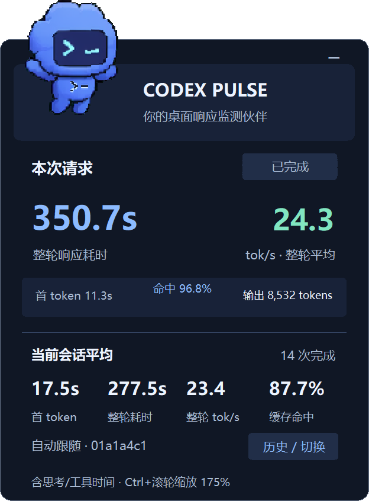
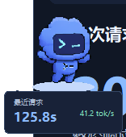
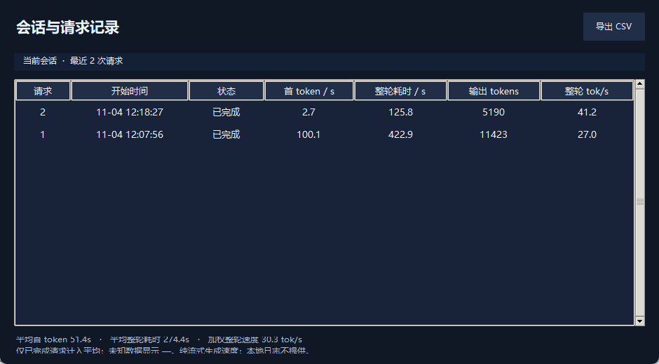

# Codex Pulse

**Windows 桌面悬浮监测宠物，查看 Codex 每轮响应、token 用量、输出速度和缓存命中率。**它直接读取 Codex 本地会话日志，不接管网络、不注入客户端，也不会额外发起模型请求。



## 界面预览

| 悬浮宠物 | 会话与请求历史 |
|---|---|
|  |  |

## 功能

- **桌面悬浮显示**：宠物动画、当前请求状态、整轮耗时和平均输出速度；支持拖动、置顶、展开与收起。
- **系统托盘**：点击展开面板顶部的 `−`、按 `Ctrl+M` 或右键选择“最小化到系统托盘”，隐藏悬浮窗并继续采集；双击托盘图标或右键选择“显示悬浮窗”恢复。托盘菜单还可打开历史记录或彻底退出。原来的展开/收起按钮改为 `⌄`，缩小宠物状态仍可通过右键菜单最小化。
- **缩放布局**：按住 `Ctrl` 滚动鼠标滚轮，或使用右键菜单选择 75%–200% 缩放；也支持 `Ctrl` + 加号/减号和 `Ctrl+0` 复位，比例会记忆。
- **响应与 token 指标**：查看首 token 等待时间、整轮响应耗时、输出 token、推理 token、整轮平均 token/s，以及当前会话平均耗时和 token/s、累计 token 消耗（以 M 为单位）。
- **缓存命中率**：显示单轮和当前会话加权平均命中率，计算为 `cached_input_tokens ÷ input_tokens`。
- **历史与导出**：按会话查看每轮请求，切换会话并导出 CSV；支持选择其他 Codex 日志目录。
- **可选自动启动**：`CodexPulseMonitor.exe` 可在检测到 Codex 桌面程序运行时启动悬浮宠物。此项需要用户自行把监测器快捷方式放入 Windows 启动文件夹。

## 下载与运行

前往 [Releases](https://github.com/Starlre/CodexPulse/releases) 下载 `CodexPulse-v1.1.0-Windows-x64.zip`，解压后运行 `CodexPulse.exe`。若需要 Codex 启动检测，将 `CodexPulseMonitor.exe` 与主程序放在同一文件夹，并按需设置快捷方式。

无需安装 Python。程序首次运行会在自身目录创建 `data` 文件夹，用于保存本地指标数据库和窗口设置。请勿将此文件夹分享给他人，它可能包含会话标识、模型、工作目录等本机统计元数据；它不保存提示词或回复正文。

如需从源码运行，环境需有 Python 3.10+ 和 Tkinter：

```powershell
python -m pip install -r requirements.txt
python -m unittest discover -s . -v
python pulse.py
```

## 指标口径与限制

- **首 token**使用 Codex 日志中的 `time_to_first_token_ms`；不一定等于界面上第一个可见字符出现的时间。
- **整轮响应耗时**使用日志中的 `duration_ms`，通常涵盖思考、工具调用和等待，不含日志未记录的界面排队时间。
- **整轮平均 token/s**为本轮输出 token 数除以整轮耗时，不等同于模型纯流式解码速度。日志按批次报告 token 用量，因此进行中的数值会随批次更新。
- **会话平均 token/s**按已完成请求的输出 token 总数除以对应总耗时计算；平均耗时为已完成请求的算术平均。
- **会话总消耗**将本地日志中每轮的输入与输出 token 相加（缓存输入已包含在输入 token 内），并以百万 token（M）显示；正在进行的请求会随日志更新。旧日志若缺少输入 token，合计只包含可读取部分，可能低估。
- **缓存命中率**按输入 token 数加权汇总。旧日志缺少缓存字段或输入 token 为零时显示 `—`，而不是 0%。
- 指标依赖本机 Codex JSONL 日志格式；Codex 更新日志字段后可能需要适配。监测数据只反映可读取的本机记录。

## 自动启动说明

主程序默认手动启动，不会安装开机启动项，也不会自行与 Codex 绑定。如果以前配置过自动启动，请删除 Windows 启动文件夹中的 `Codex Pulse Monitor.lnk` 并退出 `CodexPulseMonitor.exe`，之后启动 Codex 就不会自动拉起悬浮窗。

监测器只识别官方 Codex Windows 桌面程序路径 `OpenAI\\Codex\\bin\\codex.exe`，约每 3–8 秒检查一次。它不需要管理员权限或网络，不会因单独运行命令行 Codex CLI 而启动。用户登录后由 Windows 启动文件夹中的快捷方式运行监测器；删除该快捷方式即可取消自动启动。

## 数据与隐私

程序读取 Codex 本地会话日志来计算统计，不修改源日志、不读取密钥、不连接 Codex App Server、不创建模型会话。SQLite 数据库保存在程序目录 `data` 下，记录请求/会话 ID、时间、模型、token 数、来源路径和工作目录；不保存提示词或回复正文。建议保持 `data` 为本机私有数据，并在分享问题截图或数据库前检查其中的会话和路径信息。

## 项目文件

- `pulse.py`：Tkinter 悬浮界面、历史列表、采集线程与本地存储。
- `metrics.py`：Codex JSONL 解析、统计计算与 CSV 导出。
- `watch_codex.py`：检测 Codex 桌面进程并拉起悬浮程序。
- `test_metrics.py`、`test_layout.py`、`test_tray.py`：指标逻辑、缩放布局和 Windows 系统托盘集成测试。
- `requirements.txt`：源码运行依赖；EXE 便携版无需单独安装。
- `assets/`：宠物图标、动画帧和图像资源。

最近一次验证：21 项自动化测试通过，包含缓存命中率统计、会话加权平均、请求去重、历史兼容、缩放/DPI 布局边界，以及托盘隐藏与恢复、后台统计更新和退出清理。
